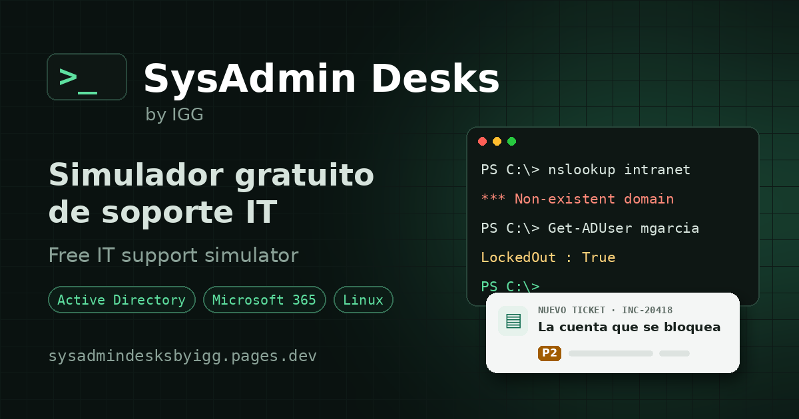

  

<h1 align="center">SysAdmin Desks by IGG</h1>

  <b>Real IT support tickets. A simulated console. No risk to anyone's servers.</b> 
  Free · English and Spanish · works in the browser

  <a href="https://sysadmindesksbyigg.pages.dev"><b>▶ Clock in and take your first ticket</b></a>
  &nbsp;·&nbsp;
  <a href="https://sysadmindesksbyigg.pages.dev/tickets/">See all 164 tickets</a>

---

## Reading about IT is not the same as fixing it

Courses explain the theory. The job is a user who cannot work, a clock that keeps running and a fix that looks right but is not. SysAdmin Desks puts you at that desk:

1. **Take the ticket.** Assign it to yourself and the SLA starts.
2. **Investigate.** Use the commands you would use at work: PowerShell, the Linux shell, a switch CLI, the directory.
3. **Fix the cause**, not the symptom. Every ticket hides a tempting wrong fix.
4. **Prove it works** and write the work note.
5. **Get your score** and an example note to compare with yours.

## From intern to DevOps

The tickets follow a career path. Start with locked accounts and full disks, then move up to servers, networks, cloud and pipelines.

| Level | You deal with | Tickets |
|---|---|---|
| Intern | First contact, inventory, basic help | 6 |
| Helpdesk Tier 1 | Everyday hardware and software incidents | 14 |
| Tier 2 | Accounts, licences, deeper diagnosis | 21 |
| Sysadmin Jr. | Network, file servers, backups | 40 |
| SysAdmin | Windows and Linux servers, virtualisation, monitoring | 51 |
| Infra / Cloud | Azure, AWS, automation | 25 |
| DevOps / SRE | Kubernetes, Terraform, Ansible, CI/CD, SLOs | 7 |

Architect, manager, director and CIO are next, as decision cases.

## What is inside

- **A real help desk.** A ticket queue with priorities, SLAs, pending states and an activity timeline.
- **Consoles that answer back.** PowerShell, Bash, Cisco IOS, ArubaOS and FortiOS, with the errors you would really see.
- **A company to look after.** Contoso's users, computers, switches, servers and mailboxes, all fictional.
- **Users to talk to.** Ask the requester questions and write the closing note they will read.
- **Labs and a library.** Guided practice by area, with a reference article for each.
- **Progress that keeps you going.** Levels, weekly goals, badges and a profile you can download.
- **A guide for every ticket.** Each desk links to its step-by-step guide on [inigogonzalezgarcia.github.io](https://inigogonzalezgarcia.github.io/guias.html), and each guide sends you back to practise.

## Free, and your progress goes with you

Sign up with email or Google and pick up where you left off on any device. There are no ads and no real systems or data: everything happens inside the simulation.

  <a href="https://sysadmindesksbyigg.pages.dev"><b>Start practising →</b></a>

---

### Want a ticket for your team?

If you have an idea for a desk, or want one adapted to your team's real tickets, get in touch:

- Website: [contact form](https://inigogonzalezgarcia.github.io/about.html#contacto)
- LinkedIn: [linkedin.com/in/igonzalez93](https://www.linkedin.com/in/igonzalez93)

How it is built, how to run it locally and how to write a new desk: [docs/technical.md](docs/technical.md) · [docs/scenario-format.md](docs/scenario-format.md)
